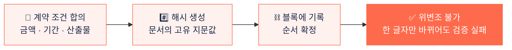

 
 

# 잇다 · ITDA

**프리랜서 거래를 막는 것은 실력이 아니라 불신입니다.** 
잇다는 블록체인에 영구 저장되는 계약서와 에스크로 결제로 
의뢰인과 프리랜서가 처음부터 서로를 믿고 시작할 수 있게 만듭니다.

 

 

## 🧩 Problem

<table>
  <tr>
    <td width="33%" valign="top">
      <h3>💸 대금 미지급</h3>
      작업을 마쳐도 대금이 들어오지 않고, 받아야 한다는 걸 증명할 수단도 마땅치 않습니다.
    </td>
    <td width="33%" valign="top">
      <h3>📄 계약서 분쟁</h3>
      구두 합의와 수정된 문서가 섞이면서 무엇이 원본인지 아무도 확인할 수 없습니다.
    </td>
    <td width="33%" valign="top">
      <h3>❓ 검증 안 된 상대</h3>
      이력도 평판도 확인하기 어려워 매번 처음부터 상대를 믿어야 합니다.
    </td>
  </tr>
</table>

 

## 💡 Solution

<table>
  <tr>
    <td width="33%" align="center" valign="top">
      <h3>🔗 블록체인 계약서</h3>
      한 번 기록된 계약서는 누구도 바꿀 수 없습니다
    </td>
    <td width="33%" align="center" valign="top">
      <h3>🔒 에스크로 결제</h3>
      대금을 먼저 예치하고 작업이 끝나면 정산합니다
    </td>
    <td width="33%" align="center" valign="top">
      <h3>💬 실시간 협업</h3>
      채팅과 작업 공유로 거래의 모든 과정을 한곳에서
    </td>
  </tr>
</table>

### 계약서가 위변조되지 않는 원리

 

## ✨ Features

| | 기능 | 설명 |
|:-:|---|---|
| 🔐 | **인증** | 이메일 및 카카오 · 구글 · 네이버 소셜 로그인 |
| 🔍 | **탐색** | 카테고리별 외주 글과 프리랜서 탐색, 검색 |
| 📑 | **계약 · 견적** | 견적서 작성, 전자 서명 계약서, 블록체인 기록 |
| 💳 | **결제** | Toss Payments 기반 에스크로 결제 |
| 💬 | **채팅** | 실시간 채팅과 거래 카드 |
| ⭐ | **리뷰 · 프로필** | 거래 완료 후 리뷰, 포트폴리오와 커리어 관리 |
| 📝 | **커뮤니티** | 마크다운 기반 게시글과 댓글 |

 

## 🛠 Tech Stack

**Frontend**

**Backend**

**Service**

**Collaboration**

 

## 📦 Repositories

| Repository | 설명 |
|---|---|
| [**23D-Web**](https://github.com/twenty-threeD/23D-Web) | 잇다 웹 클라이언트 · Next.js |

 

## 👥 Contributors

 
 

대구소프트웨어마이스터고등학교 · Team 23D

 

